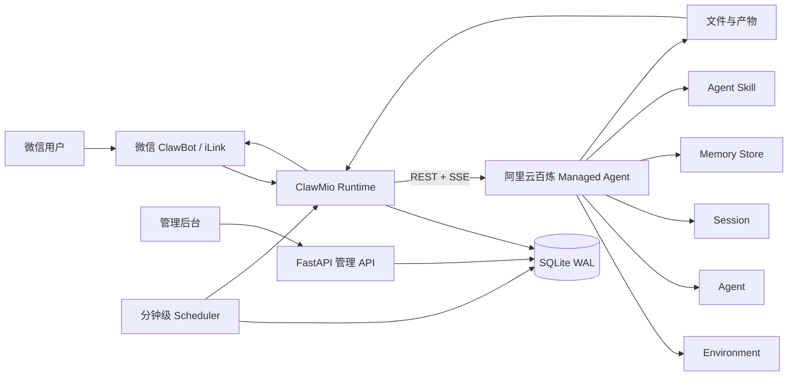

# ClawMio：用阿里云百炼 Managed Agent 把多 Bot AI 助理带进微信

> **项目状态：Incubating Community Project / 孵化中社区项目**  
> ClawMio 是由原作者独立维护的社区开源项目。ModelStudio AI 对该项目的收录，旨在呈现基于阿里云百炼构建完整产品的工程实践，不代表 ClawMio 成为阿里云官方产品，也不代表双方存在隶属关系。

- **项目仓库**：[Fantast616/ClawMio](https://github.com/Fantast616/ClawMio)
- **维护者**：[@Fantast616](https://github.com/Fantast616)
- **许可证**：MIT License
- **核验基线**：`main` 分支提交 [`32909e3`](https://github.com/Fantast616/ClawMio/commit/32909e3ad1bb0acc58f15bf50c6412a722a5b45e)
- **仓库所示版本**：`v0.0.1`（项目创建时间较短，持续维护情况尚待观察）

## 项目概览

ClawMio 是一个 Python / FastAPI + SQLite 应用，提供中文管理后台，用一个控制面管理多个微信 Bot。用户从微信发起任务，ClawMio 负责接入、身份、会话、调度、预算和结果回传，实际的 Agent 执行则交给阿里云百炼 Managed Agent。

这个架构瞄准的不是“再做一个聊天机器人”，而是降低多人 AI 助理服务的交付成本：部署者只运行一个本地控制面，每个 Bot 使用独立会话与长期记忆，模型、工具和文件任务在云端按量执行。

当前项目主要面向：

- 为多人提供 AI 助理服务的开发者和运营者；
- 希望通过微信交付资料检索、文件处理、内容生成和定时汇总的小团队；
- 想快速验证 AI 助理产品、但不愿为每位用户维护独立运行环境的独立开发者；
- 由部署者统一提供服务、不自行维护 Agent 环境的微信用户。

项目目前仍是单管理员、单进程实现，适合作为原型和早期服务的起点，不是完整的多租户 SaaS、支付平台或高可用集群方案。


*微信 Bot 工作台：连接状态、长期记忆、会话历史与额度管理。图片来自 ClawMio 仓库。*

## 为什么这个案例值得关注

从代码与文档设计看，ClawMio 探索了阿里云百炼 Managed Agent 如何进入“面向真实用户持续交付”的产品链路，而不只停留在一次模型请求。项目已经实现或描述了以下组成部分；真实微信与云端服务的完整端到端链路仍需按后文清单使用真实账号验收：

1. 微信身份与 Bot 绑定；
2. Agent、Environment、Session 和 Memory Store 的资源管理；
3. 图片与文件上传、审核、挂载和结果回传；
4. 长期记忆与多轮会话；
5. 定时任务和独立 Session；
6. 本地预算、用量差值与欠费拦截；
7. 给单个 Bot 暴露自然语言自助 Skill。

这使它不仅是一个“阿里云百炼调用示例”，更接近一个完整但仍处于早期的 AI 服务控制面。

## 端到端架构



在当前实现里：

- `app/runtime.py` 负责微信消息、每 Bot 锁、附件处理、Agent 运行、中断和恢复；
- `app/ma.py` 封装 Managed Agent REST / SSE、Session、文件与产物事件；
- `app/store.py` 负责 SQLite、迁移、消息去重、会话与 Token 持久化；
- `app/billing.py` 维护本地费率快照、累计用量差值与原子扣费；
- `app/schedules.py` 管理每天、每周、间隔和单次定时任务；
- `skills/claw-bot-self-service/` 让每个 Bot 用自然语言查询余额、重开会话和管理定时任务。

ClawMio 当前要求单个 FastAPI 进程和单个 Uvicorn worker。SQLite 采用 WAL，但项目未引入 Redis、Celery 或外部队列。这个取舍让部署简单，也决定了它当前更适合小规模验证，而不是水平扩展场景。

## 阿里云百炼如何进入运行时

ClawMio 不是通过 OpenAI 兼容 API 直接调用单个模型。它使用的是阿里云百炼 Managed Agent 的 AgentStudio REST / SSE 接口：

```text
https://{workspace}.{region}.maas.aliyuncs.com/api/v1/agentstudio
```

鉴权和工作空间配置来自：

```dotenv
DASHSCOPE_API_KEY=你的阿里云百炼工作空间 API Key
BAILIAN_WORKSPACE_ID=你的工作空间 ID
BAILIAN_REGION=cn-beijing
```

运行时链路如下：

### 1. 创建或复用 Agent 与 Environment

首次初始化时，部署者提供阿里云百炼工作空间 API Key、Workspace ID 和 Region。项目的 CLI / bootstrap 流程可以预览待创建资源，再在显式确认后创建 Environment 和 Agent。模型默认使用 `auto`，也可以通过 `--model 模型ID` 选择当前工作空间支持的模型。

### 2. 为每个 Bot 创建独立记忆和会话

微信 Bot 绑定后，后端为其创建独立 Memory Store；新 Session 以 `read_write` 方式挂载该 Memory Store。这个实现用于在应用逻辑中分开不同 Bot 的长期记忆，但不能据此推断已经具备云端权限隔离或完整的多租户安全能力。

### 3. 将文件挂载到 Agent 会话

图片或文件先由 ClawMio 上传到阿里云百炼，再等待文件状态符合要求，最后挂载到 Session。Agent 可以结合模型、工具和 Skill 完成理解、处理和生成。

### 4. 用 SSE 接收执行过程和结果

ClawMio 通过 Server-Sent Events 接收 Agent 执行事件，并将事件归一化为回复、工具调用、用量、文件产物等本地状态。必要时也会读取历史事件补齐结果。

### 5. 将产物送回微信

Agent 将文件写入约定目录并调用 `mark_artifacts` 注册产物。后端只接受当前执行轮次中符合资源 ID 和来源条件的 `file_*` 产物，下载后回传微信；这属于应用级资源校验，不代表已经验证文件内容本身安全。当前本地微信回传限制为单文件 10 MB。

## 首次跑通路径

项目要求 Python 3.11+。按照当前仓库说明，最短验收流程是：

1. 准备阿里云百炼 Managed Agent 工作空间、API Key、Workspace ID 和 Region；
2. 安装 ClawMio 的 wheel、发布包或源码；
3. 运行 `clawmio start --open`，按向导配置资源；
4. 先预览 Environment、Agent 和工具权限，再显式确认创建；
5. 登录管理后台，在“MA 资源”中确认 Agent 与 Environment 可用；
6. 添加 Bot，并使用微信扫码完成绑定；
7. 等待初始 Session 和专属 Memory Store 创建完成；
8. 从微信发送一条文字消息，检查执行记录与回复；
9. 测试 `/usage` 与 `/clear`；
10. 再逐项启用文件、预算扣费、自助 Skill 和定时任务。

生产部署时，仓库建议使用非 root 用户、独立持久化目录、单进程 systemd 服务和 HTTPS 反向代理。

## 本地预算与费用管理

ClawMio 内置的费用模块是本地预算账本，不是阿里云官方账单，也不包含支付充值系统。

管理员需要按 Agent 配置本地费率。每轮任务完成后，系统以 Session 累计用量减去上一次 checkpoint，计算：

- 普通输入 Token；
- 缓存读取与创建；
- 输出 Token；
- 活跃时间；
- 按 `call_id` 去重的 `web_search` 调用。

余额不大于 0 时，系统拒绝新的任务执行，但仍允许用户查询 `/usage`。由于当前没有单轮预授权，执行结束后余额可能变为负数。首次启用本地计费时只建立用量基线，不追补此前的历史用量；若平台用量字段缺失或查询异常，相关任务可能进入待结算状态。若管理员没有配置价格，ClawMio 不会本地扣费或拦截，但阿里云百炼侧仍可能产生平台费用。

因此，项目截图中的费率只代表部署者的本地配置，不能作为阿里云百炼官方报价或可靠对账结果引用。


*费用与额度页。这里展示的是 ClawMio 本地预算规则，不是阿里云官方账单。*

## 工程取舍

ClawMio 当前几个重要取舍都写得比较明确：

### 云端执行，本地控制

模型、Agent、Session、Memory Store 和文件执行位于阿里云百炼；管理后台、SQLite、微信接入、预算和任务调度位于部署者自己的服务中。这减少了本地模型与运行环境维护成本，但仍要求部署者保护好本地数据库、日志和密钥。

### 每个 Bot 独立记忆

每个 Bot 使用独立 Memory Store 与 Session，不通过一套共享会话承载所有用户。它有利于隔离用户上下文，但并不等同于完整的多租户权限系统。

### 定时任务使用独立 Session

定时任务不会替换微信聊天会话，而是新建一次性 Session 执行，再将结果回传微信。这避免了后台任务污染聊天上下文，但也带来云端任务状态、主动消息限制和失败核对问题。

### 简化部署优先于横向扩展

单进程和 SQLite 降低了第一次部署成本；相应地，多 worker、分布式调度、组织级权限与高可用不在当前版本范围内。

## 安全边界

ClawMio 的安全说明明确列出了当前风险：

- `.env`、SQLite、备份和日志可能包含敏感内容；
- Bot Token 是长期有效凭证；
- SQLite 中保留 Token 原文，尚未实现静态加密和自助轮换；
- Agent 工具能够访问挂载文件和 Session 环境变量；
- 工具审批不应因为部署方便而被统一绕过；
- 暂停或归档 Bot 不代表取消已在云端运行的任务；
- 项目不具备完整的多租户权限隔离、支付结算和审计能力。

初始化脚本当前显式启用 `bash`、`read`、`write`、`edit`、`glob`、`grep`、`web_search` 和 `mark_artifacts`，并使用 `always_allow` 策略支持自动执行。鉴于长期 Bot Token 仍以原文保存、且高风险工具可以自动执行，当前安全基线不应直接视为生产就绪。

对于公开部署或商业服务，凭证保护与轮换、工具最小权限和审批策略属于上线阻断条件，必须实现并使用真实链路验证。至少包括：

- 为敏感 Token 增加静态加密或外部 Secret 管理；
- 建立 Token 轮换和撤销流程；
- 检查日志、备份和错误页面是否泄露凭证；
- 不将 Bot Token 写入共享 Agent 或公共 Skill；
- 按工具风险设置审批策略；
- 使用 HTTPS；
- 验证归档、暂停、超时和重试时的远端任务状态；
- 开启 GitHub Secret scanning，并在提交前人工检查 staged diff。

## 当前限制

截至本案例核验基线，项目存在这些已知限制：

- 单管理员、单进程；
- 没有多租户组织权限；
- 没有支付充值系统；
- 没有高可用集群能力；
- 微信入站支持文字、图片与文件，不支持语音和视频；
- 单文件本地回传上限为 10 MB；
- Bot 容量取决于消息频率、云端限额、网络和服务器资源，不提供固定承诺；
- 微信主动发送受登录状态和消息上下文限制；
- 不提供跨系统端到端 exactly-once 保证；
- 暂停或归档不会取消已提交的云端任务。

这些边界不是隐藏缺陷，而是当前版本必须明确告知部署者的工程范围。

## 测试状态与待验证项

项目提供自动化测试，使用临时 SQLite、假凭证和 `httpx.MockTransport` 验证业务逻辑，不需要真实 `.env`。这些测试可以覆盖大量状态机和数据逻辑，但不能证明真实外部链路已经可用。

在把 ClawMio 用于公开服务前，仍需使用真实账号逐项验证：

- 微信扫码与消息收发；
- Managed Agent 权限；
- 所选模型及多模态能力；
- 图片与文件审核；
- 产物下载和微信回传；
- Managed Agent 沙箱到 ClawMio 后端的网络连接；
- 平台当前用量字段与计费口径；
- 定时任务和主动消息限制。

此外，项目目前没有承诺固定 Bot 容量、安全响应 SLA 或长期版本支持周期。

## 与 ModelStudio AI 的关系

本页面是 ModelStudio AI 社区项目案例的 Incubating 记录，用于评审 ClawMio 与阿里云百炼 Managed Agent 的技术关联、可复现性和安全边界。

当前收录不表示双方已经形成官方合作、资源支持、商业承诺或 Org Profile 推荐。项目代码、品牌、Issue、Release 和维护决策仍由原仓库维护者负责。待维护者确认案例内容、真实端到端链路完成验收并满足后文升级条件后，再讨论进一步社区展示或共建。

## 孵化状态与升级条件

本案例暂定状态为 `Incubating`，原因是项目仍处于超早期阶段。升级为 `Verified` 前，建议至少满足：

- CI 持续通过；
- 真实微信 + Managed Agent 端到端链路完成验收；
- 凭证存储和工具审批风险得到处理；
- 出现一个公开、可复现的真实业务案例；
- 有持续维护记录；
- 核心维护不再完全依赖单一贡献者。

这些条件满足后，再考虑在 ModelStudio AI Org Profile 中将项目提升为重点社区项目。

## 进一步阅读

- [ClawMio README](https://github.com/Fantast616/ClawMio/blob/32909e3ad1bb0acc58f15bf50c6412a722a5b45e/README.md)
- [架构说明](https://github.com/Fantast616/ClawMio/blob/32909e3ad1bb0acc58f15bf50c6412a722a5b45e/docs/architecture.md)
- [接入材料清单](https://github.com/Fantast616/ClawMio/blob/32909e3ad1bb0acc58f15bf50c6412a722a5b45e/docs/prerequisites.md)
- [部署指南](https://github.com/Fantast616/ClawMio/blob/32909e3ad1bb0acc58f15bf50c6412a722a5b45e/docs/deployment.md)
- [资源初始化](https://github.com/Fantast616/ClawMio/blob/32909e3ad1bb0acc58f15bf50c6412a722a5b45e/docs/bootstrap.md)
- [计费说明](https://github.com/Fantast616/ClawMio/blob/32909e3ad1bb0acc58f15bf50c6412a722a5b45e/docs/billing.md)
- [安全说明](https://github.com/Fantast616/ClawMio/blob/32909e3ad1bb0acc58f15bf50c6412a722a5b45e/SECURITY.md)
- [界面截图](https://github.com/Fantast616/ClawMio/blob/32909e3ad1bb0acc58f15bf50c6412a722a5b45e/docs/screenshots.md)
- [贡献指南](https://github.com/Fantast616/ClawMio/blob/32909e3ad1bb0acc58f15bf50c6412a722a5b45e/CONTRIBUTING.md)

---

## Incubation 确认清单

以下事项尚未完成，因此该项目保持 `Incubating` 状态：

1. 是否认可 `Incubating Community Project` 的状态标记；
2. 是否同意 ModelStudio AI 使用仓库中的界面截图；
3. 是否有可公开的真实微信 + Managed Agent 端到端案例；
4. CI 当前失败的具体原因与修复计划；
5. 是否愿意在 README / CLI / 控制台加入带 `source_channel` 的阿里云百炼入口；
6. 是否愿意共同维护旅行助理、商家客服或定时资讯等 Agent 模板；
7. LICENSE 中 `ClawBridge contributors` 与项目名称不一致是否为有意保留。
